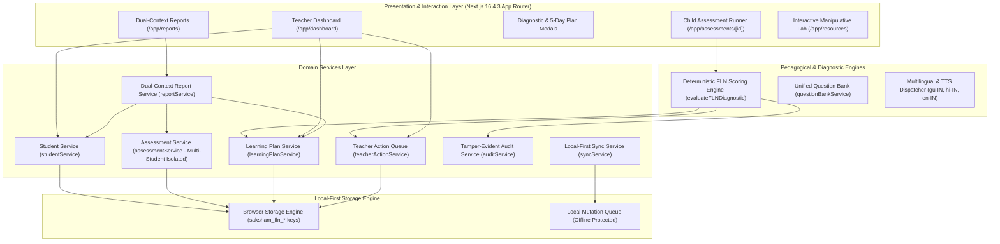

# Saksham FLN — System Architecture & Technical Specifications

**Problem Statement:** PS000034  
**Domain:** Foundational Literacy and Numeracy (FLN) EdTech  
**Context:** Collector Office — Devbhumi Dwarka, Gujarat  
**Target Users:** Students (Standards 1–8), Primary School Teachers, Head Teachers, CRC/BRC Coordinators, District Education Officers, and Guardians.

---

## 1. Architectural Philosophy

Saksham FLN is built on three core engineering tenets:

1. **Explainable Diagnostic Pedagogy (No Black-Box Scoring):**  
   Every score, gap identification, and activity recommendation is produced deterministically through curriculum-calibrated prerequisite graphs. When a student chooses an incorrect option, the system diagnoses the specific cognitive misconception (e.g., positional digit reversal, face-value confusion, phonemic length mismatch) rather than assigning a blunt percentage.

2. **Honest Local-First Resilience (Offline by Design):**  
   Designed specifically for rural government schools across Devbhumi Dwarka with intermittent or zero internet connectivity. All student dossiers, assessment attempts, learning pathways, and teacher actions persist durably in client storage (`localStorage` & `IndexedDB`). Operations are queued with audit timestamps and stage markers.

3. **Restrained Liquid Glassmorphism & Indic Accessibility:**  
   The UI utilizes an Apple-inspired glassmorphism system calibrated for high readability. Background blurs, subtle borders, and layered surfaces provide visual hierarchy without sacrificing text clarity. 24 self-hosted Indic WOFF2 fonts guarantee zero layout shift (CLS = 0) and prevent matra or conjunct clipping in Gujarati and Hindi.

---

## 2. System Architecture Diagram

---

## 3. Core Component Breakdown

### 3.1 Explainable Diagnostic Scoring Engine (`lib/fln-scoring-engine.ts`)
- **Attempt vs. Unattempted Separation:** Evaluates attempted questions for accuracy and evidence coverage separately. Unattempted questions trigger an explicit `"Insufficient Evidence"` classification and recommend a brief 1-on-1 oral check, preventing false gap inferences.
- **Micro-Competency Prerequisite Mapping:**
  - `guj-matra`: Gujarati vowel markers and phonics discrimination.
  - `guj-comprehension`: Contextual noun retrieval from 5-word decodable sentences.
  - `num-bundling`: Concrete grouping of 10 units into 1 decade bundle.
  - `num-decomposition`: Expanding 2-digit numbers into tens value and units value ($40 + 7 = 47$).
  - `num-regrouping`: Concrete intuition for unit-to-decade exchange ($18 = 1\text{ bundle} + 8\text{ loose}$).
- **Automated 5-Day Remedial Pathway Generation:** Converts diagnosed gaps into day-by-day classroom manipulatives (straws, decade mats, flashcards) with teacher scripts.

### 3.2 Multi-Student Assessment Isolation (`lib/services/assessmentService.ts`)
- Assessment attempts are tracked uniquely by composite key (`assessmentId` + `studentId`).
- An assessment with multiple target learners increments `completedCount` upon each student's attempt submission.
- The overall assessment status transitions from `Scheduled` $\to$ `In Progress` $\to$ `Completed` only when **all** target learners have completed their assessments.

### 3.3 Multilingual Speech & Typography Pipeline
- **Authentic Indic Scripts:** Bundles 24 self-hosted WOFF2 font files:
  - *Noto Sans Gujarati* (9 weights: 100 to 900)
  - *Noto Sans Devanagari* (9 weights: 100 to 900)
  - *Inter* (6 weights: 100 to 900)
- **Web Speech Synthesis Fallback:** Text-to-speech queries local browser speech synthesis using language tags `gu-IN`, `hi-IN`, and `en-IN`. When speech synthesis voices are unavailable in a browser, a visual transcript drawer automatically reveals the text so learning is never blocked.
- **Zero Cross-Language Audio Leaks:** Fixed previous audio bug where Hindi mode spoke Gujarati text. Hindi mode now speaks and displays dedicated Hindi prompts, option labels, and audio transcripts.

### 3.4 Honest Dual-Context Reporting (`lib/services/reportService.ts`)
- **Current Workspace Records:** Dynamically calculated from active student records, teacher actions, and completed activities on the current device.
- **Sample Presentation Dataset:** Provides an illustrative cluster- and district-wide model representing 18,450 learners across Devbhumi Dwarka for jury review.
- **RFC 4180 Compliant CSV Export:** Implements proper quotation and escaping for cells with commas, quotes, or newlines.

---

## 4. Security & Audit Trail

- Every status change, assessment submission, plan approval, and activity log generates a tamper-evident audit entry in `auditService`.
- Events capture `actorId`, `actorName`, `role`, `eventType`, `entityType`, `entityId`, and human-readable pedagogical summary.
