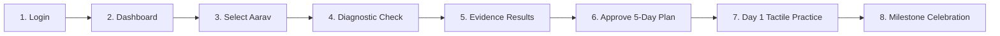

# Saksham FLN — Hackathon Jury Demonstration Guide

**Project:** Saksham FLN  
**Problem Statement:** PS000034  
**Stakeholder:** Collector Office — Devbhumi Dwarka, Gujarat  
**Live URL:** [https://sakshamfln.vercel.app/](https://sakshamfln.vercel.app/)

---

## 🌟 The 8-Stage Guided Demo Journey

Saksham FLN features a top banner guide with quick-jump controls allowing evaluators and jury members to witness the complete foundational learning loop in under 3 minutes.

---

### Step-by-Step Walkthrough

### Stage 1: Role-Based Authentication
1. Navigate to `/login` or click **1. Login** on the demo banner.
2. Select **Teacher (Asha Primary School - Class 3A)**.
3. Observe quick one-click role switching available for:
   - Primary School Teacher
   - Head Teacher (School Administrator)
   - Cluster Resource Centre (CRC) Coordinator
   - District Education Officer (DEO)
   - Guardian / Parent

### Stage 2: Classroom Workspace Overview
1. Open the Teacher Dashboard (`/app/dashboard`).
2. Review the class health metrics (Class 3A roster, FLN literacy & numeracy percentages).
3. Check the **Daily Prioritized Action Queue** showing pending remedial tasks.

### Stage 3: Select Target Student (Aarav Kumar)
1. In the Student Grid, click on **Aarav Kumar (Roll #14)**.
2. View Aarav's student profile modal:
   - Current status: *Needs Support*.
   - Prerequisite diagnosis: Hesitates on place-value bundling when crossing decade boundaries.
   - Longitudinal progress bar: 25%.

### Stage 4: Administer FLN Screening Check
1. Click **Start Diagnostic Check** or jump to **4. Assess**.
2. Experience the child-friendly runner:
   - One question per screen.
   - Text-to-speech audio button (Speaks in Gujarati, Hindi, or English matching active locale).
   - Click **Load Demo Scenario** to preload Aarav's screening answers (or answer manually).
   - Click **Submit Screening**.

### Stage 5: Explainable Diagnostic Results & Misconception Deduction
1. Inspect the generated diagnostic dossier:
   - Overall score: 80% (4/5 correct).
   - Evidence coverage: 100%.
   - **Root-Cause Finding:** Shows Question 3 mistake (`opt-3b`: child wrote 43 instead of 34).
   - Engine explains: *Positional Reversal Misconception — Child recognized quantities 3 and 4, but inverted the tens and ones place value order.*
   - Differentiates confirmed practice gaps from unattempted items (*Insufficient Evidence*).

### Stage 6: Review & Approve 5-Day Remedial Pathway
1. Click **Review 5-Day Learning Plan** or jump to **6. Approve**.
2. Review the daily micro-intervention sequence:
   - **Day 1:** Pencil & Straw Bundles: Grouping 10s and 1s (12 mins).
   - **Day 2:** Dual-Column Tens Mat: Number Construction (15 mins).
   - **Day 3:** Decade Leap Partner Game (10 mins).
   - **Day 4:** Expanded Form Flashcard Overlay (12 mins).
   - **Day 5:** Class 3 Regrouping Check & Mastery Reflection (10 mins).
3. Review physical manipulative requirements and the Gujarat curriculum alignment (GCERT Class 3 Sem 1 LO-M304).
4. Click **Sign Off & Approve Remedial Plan**.

### Stage 7: Conduct Day 1 Tactile Manipulative Activity
1. Navigate to `/app/resources/res-num-bundling-01` or click **7. Practise**.
2. Engage with the **Interactive Straw Bundling Simulator**:
   - Add/remove bundles of 10 drinking straws and single loose straws.
   - See dynamic total updates ($3\text{ tens} + 4\text{ ones} = 34$).
3. In the sidebar, record formative teacher observation notes:
   - *"Aarav successfully bundled 30 straws with rubber bands and distinguished tens from loose units."*
4. Click **Mark Activity Complete**.

### Stage 8: Review Progress & Longitudinal Growth
1. View Aarav's updated profile:
   - Progress updated to 50%.
   - Overall status promoted from *Needs Support* $\to$ *Developing*.
   - Milestones This Week counter incremented.
   - Tamper-evident entry added to Audit History (`/app/audit-history`).

---

## 📴 Testing Offline Resilience
1. In the top navigation bar, click the **Device Synchronization & Offline State** icon.
2. In the drawer, click **Enable Offline Mode**.
3. Notice that network status changes to *Simulated Offline Mode (Rural School Mode)*.
4. Continue recording student observations or approving plans. Mutations are safely buffered into the local queue.
5. Disable offline mode and click **Verify Local Integrity** to confirm local storage health.

---

## 🌐 Multilingual Demonstration
1. Click the Language selector in the top bar.
2. Switch between **English**, **ગુજરાતી (Gujarati)**, and **हिन्दी (Hindi)**.
3. Observe:
   - Full interface localization with authentic Indic typography (Noto Sans Gujarati & Devanagari).
   - Zero layout shift (CLS = 0) and zero matra clipping.
   - Text-to-speech audio speaks in the active language without cross-language audio leaks.

---

## 🔄 Resetting the Demo
- Click **Reset Demo** on the top demo banner.
- All workspace stores, student scores, attempts, and audit logs are reset to the initial baseline.
- **Language preservation:** The user's active language selection (`saksham_fln_locale`) is strictly preserved across resets.
